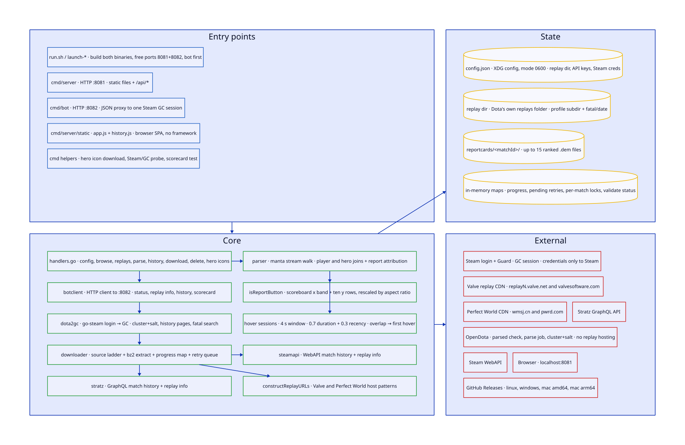

# HUMANS

A local Dota 2 replay lab that infers **when and against whom** the in-game report button was used, by walking replay entities instead of reading any report API.

## Read it left to right

- **Two binaries and a browser, no daemon.** `run.sh` rebuilds both every start, frees ports 8081/8082, then launches `bot` before `server`; only the bot process ever holds a Steam GC session, and the server talks to it over JSON HTTP on `localhost:8082`. That seam is why `server` can restart without a new Steam Guard code.
- **No click is ever observed.** The parser reads each player's cursor from `CDOTAPlayerController.m_iCursor`, upscales it from the compressed 510×383 space to 1920×1080, and tests a scoreboard-relative x band plus ten y rows in `isReportButton`. `m_flAspectRatio` rescales the board width, and `m_iStatsPanel == 1` is what distinguishes "hovering a report row" from a cursor that merely happens to sit there while the scoreboard is closed.
- **A report is a scoring contest, not an event id.** Hover sessions are timed per reporter/target pair; a candidate must have a valid hover within 4 seconds of the confirm box, then wins with `0.7 × duration + 0.3 × recency`. When the ten rows overlap (the 6/7/8 ranked-report layout), the code switches to a first-hover rule instead of last-hover. The confirm box itself is a fixed screen rectangle (x 968–1159, y 844–889) with an 11-tick grace period after the scoreboard closes — the comment says 300 ms, but 11 ticks at 30 Hz is ~366 ms.
- **Replay acquisition is a fallback ladder, and the GC is the only authenticated rung.** GC replay info → Steam WebAPI → Stratz → OpenDota. OpenDota does not host files: it returns cluster and salt, which `constructReplayURLs` turns into Valve CDN URLs plus Perfect World mirrors (`wmsj.cn`, `pwrd.com`). A 5xx from OpenDota parks the match in an in-memory retry queue; "GC-only" mode simply disables the last rung.
- **Parsing is a streaming side-effect machine with deliberate early exits.** `manta` walks the replay; game start comes from `GamerulesStateChanged == 5`, pause time from `CDOTAGamerulesProxy`, and match time is `(tick − begin − paused) / 30`. The walk stops as soon as all connected players have names and heroes, or at 150k ticks, by returning sentinel errors that are caught outside the callback. Nothing parsed is cached — the endpoint returns JSON and the next request re-walks the file.

---
Diagram source: [`docs/system.d2`](docs/system.d2) · render with [`scripts/render-diagram.sh`](scripts/render-diagram.sh) (writes `docs/system.svg` and `docs/system.png`).
